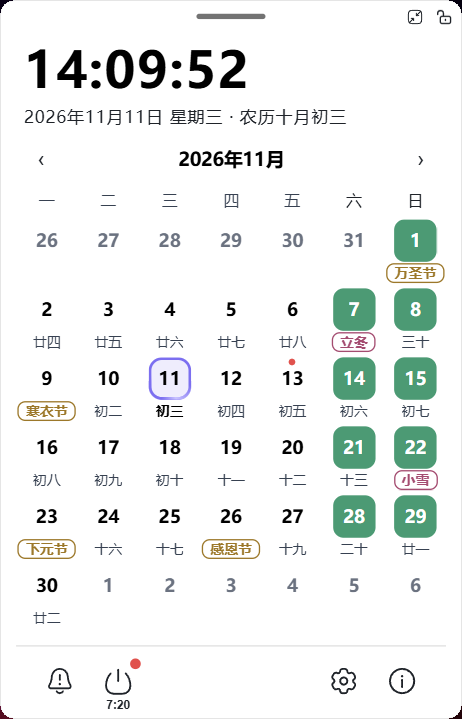

# 小猪日历 PiggyCalendar

Windows 桌面悬浮日历小工具，常驻桌面一角，同时管着提醒和自动关机。

## 主要功能

### 日历

- 月视图悬浮窗，可拖动、可缩放、可锁定，窗口位置与尺寸记忆
- 公历 + 农历双历显示，含节气与传统节日
- 节假日与调休标记：**休 / 班** 角标，补班日单独配色
- 点击日期查看当天详情；悬停显示节日、农历与当天提醒摘要
- 右键日期可直接添加提醒或管理当天提醒

### 提醒

- 重复规则：单次 / 每天 / 工作日 / 每周 / 每月 / 每年
- 工作日支持「每个工作日 / 每周第 N 个工作日 / 每月第 N 个工作日」，可倒数序号
- 每年支持公历与农历两种口径，农历按真实农历月日换算
- 提前提醒可逐项叠加（5 分钟 ~ 1 周共 11 档，最多 10 项）
- 到点弹窗支持「稍后提醒」，循环提醒按日去重
- 快速提醒：以倒计时方式临时创建一次性提醒，底部实时显示剩余时间

### 自动关机

- 可设定单次或按周期（每天 / 每周 / 每月）自动关机
- 关机前可按档提前提醒，到点显示倒计时确认窗

### 外观

- 主题色与不透明度可调，窗口支持纯色与毛玻璃两种质感
- 节日、节气、节假日、周末、补班、农历文字分别配色与描边样式
- 深浅色自适应，月历数字与标记按统一视觉规范绘制

### 节假日数据

- 内置多数据源在线同步，可自定义源地址与启用顺序
- 支持手动增删节假日与调休日，手动数据优先于在线数据
- 同步失败自动回退，本地数据始终可用

### 系统集成

- 托盘常驻，开机自启可开关
- 单实例运行，重复启动会唤回已有窗口
- 多屏适配：按窗口所在屏幕的 DPI 缩放，支持混合缩放的多显示器环境
- 数据全部本地保存（提醒、节假日、配置），断网也可正常使用

## 系统要求

- Windows 10 1809 及以上、Windows 11（**32 位与 64 位均可**）
- Microsoft Edge WebView2 Runtime（Win11 与多数 Win10 已内置；若缺失，程序启动时会直接提示并引导安装）
- 绿色单文件，无需安装运行库，解压后直接运行

## 下载与升级

正式版本发布在仓库的 **Releases** 页面，下载 `PiggyCalendar.WebShell.<版本>.exe` 单个文件即可运行。

程序在 EXE 同目录创建 `运行组件` 文件夹，存放配置、提醒数据、节假日数据与 WebUI 缓存；升级时保留该目录即可延续原有设置。

## 许可

原创代码采用 **PolyForm Noncommercial License 1.0.0**：个人与非营利使用免费，商业用途需单独授权，详见 [LICENSE](LICENSE) 与 [COMMERCIAL.md](COMMERCIAL.md)。

第三方组件与数据集保留各自许可，清单见 [THIRD-PARTY-NOTICES.md](THIRD-PARTY-NOTICES.md)。

## 技术栈

.NET Framework 4.7.2（WPF）+ WebView2 + Vue 3 + Element Plus；前端资源作为嵌入资源打包，经 Costura 合并为单文件 EXE。
